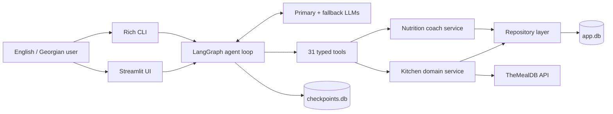
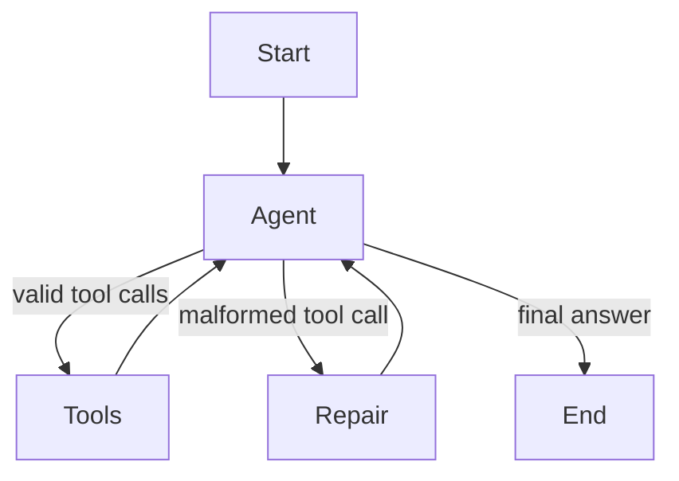

<div align="center">
  
  <h1>ქონდაქარი · Kondakari</h1>
  <p><strong>A bilingual kitchen, nutrition, and fitness agent built with Python, LangChain, and LangGraph.</strong></p>
  <p>Pantry management · calorie and macro tracking · exact-calorie menus · recipes · workouts · progress coaching</p>
</div>

---

ქონდაქარი is a stateful AI agent that combines natural conversation with deterministic nutrition calculations and persistent structured data. It understands English and Georgian, can choose between more than 30 tools, and is available through both a polished Streamlit client and a Rich terminal client.

The central design principle is simple:

> The language model decides **what action is needed**, while Python and SQLite remain responsible for **facts, calculations, validation, and persistence**.

This avoids asking the model to invent calorie totals, perform important health arithmetic, or treat chat history as a database.

## What it can do

### Nutrition and health

- Build a body profile from age, sex, height, weight, activity level, and goal.
- Calculate BMI, BMR, TDEE, and daily calorie/macronutrient targets.
- Support weight loss, maintenance, weight gain, and body recomposition.
- Enforce conservative calorie floors and safe rate limits.
- Log food in grams or familiar pieces, such as `5 khinkali`.
- Track calories, protein, carbohydrates, and fat by day and meal.
- Log workouts and estimate energy use from MET values and body weight.
- Calculate weight trends, adherence, and estimated time to a target weight.
- Answer general questions about meal timing, fasting, fibre, micronutrients, supplements, cravings, labels, eating out, and sustainable dieting.

### Exact menu construction

- Generate up to 12 distinct daily menus for an exact calorie target.
- Generate standalone snack options for exact targets from 100–1,000 kcal.
- Support omnivore, pescatarian, vegetarian, and vegan diets.
- Enforce saved allergies, dislikes, and explicit exclusions.
- Optimize realistic gram portions with bounded least-squares.
- Save menu sets and log a selected menu directly into the food diary.

### Kitchen management

- Store pantry items with quantity, unit, location, and expiry date.
- Highlight expired and soon-to-expire ingredients.
- Suggest recipes based on pantry coverage and expiring food.
- Search TheMealDB by recipe name or ingredient.
- Save recipes, ratings, and personal notes.
- Build a dated meal plan.
- Generate a shopping list from planned recipes minus pantry contents.
- Move purchased shopping items into the pantry.

### Bilingual interaction

- Responds in Georgian when the user writes in Georgian.
- Responds in English when the user writes in English.
- Food records include both English and Georgian names.
- Georgian food aliases are supported by the nutrition database.

## Interfaces

### Streamlit client

The main client uses a calm gastronomic design, the ქონდაქარი chef logo, and four focused views:

- **Home** — daily calories, macros, food diary, pantry alerts, and movement.
- **Chat** — bilingual conversation with a visible thinking indicator.
- **Pantry** — searchable inventory with location and expiry filters.
- **Menus** — generated menu sets with portions and macro totals.

Start it with:

```powershell
.\.venv\Scripts\kondakari-ui
```

Then open [http://localhost:8501](http://localhost:8501).

### Rich CLI

The original terminal client remains fully supported:

```powershell
.\.venv\Scripts\kondakari
```

Useful commands:

```text
/today       today's diary and remaining targets
/profile     body profile and calculated targets
/menus       latest generated menus
/pantry      pantry inventory
/plan        next seven days of meals
/shopping    shopping list
/new         new conversation
/threads     saved conversations
/switch ID   resume a conversation
/quit        exit
```

## Architecture



### Request lifecycle

1. The client sends a `HumanMessage` with a persistent `thread_id`.
2. LangGraph builds a fresh system message containing:
   - today’s date,
   - saved preferences,
   - body profile and targets,
   - today’s intake,
   - expiring pantry items.
3. The LLM either answers directly or emits a typed tool call.
4. `ToolNode` validates arguments through Pydantic and invokes the selected tool.
5. Tools call domain services rather than executing SQL directly.
6. Tool results return as structured JSON.
7. The model converts those results into an English or Georgian answer.
8. LangGraph checkpoints the conversation in SQLite.

The explicit graph is:



The project uses an explicit graph instead of hiding the reasoning loop behind a prebuilt agent helper. This makes tool repair, error handling, fallback behavior, and checkpoints visible and testable.

## Tool groups

All tools have descriptions and Pydantic argument schemas, allowing the model to select and call them dynamically.

| Group | Representative tools |
|---|---|
| Pantry | `add_pantry_items`, `list_pantry`, `use_pantry_item` |
| Recipes | `search_recipes`, `find_recipes_by_ingredient`, `get_recipe`, `suggest_recipes_from_pantry`, `save_recipe` |
| Meal planning | `plan_meal`, `get_meal_plan`, `generate_shopping_list`, `mark_items_bought` |
| Preferences | `set_preference`, `remove_preference`, `convert_units` |
| Nutrition | `update_body_profile`, `get_nutrition_targets`, `search_foods`, `log_food`, `get_daily_summary` |
| Fitness | `log_weight`, `log_workout`, `get_progress` |
| Menu optimization | `generate_menus`, `generate_snack_ideas`, `log_menu` |

## Data management

The application deliberately separates conversation state from domain data.

### `data/app.db`

Owned by the application and accessed through repositories:

| Table | Purpose |
|---|---|
| `threads` | Conversation metadata and titles |
| `pantry_items` | Ingredient quantities, locations, and expiry dates |
| `recipes` | Cached recipes plus favourites, ratings, and notes |
| `meal_plan` | Recipe assigned to a date and meal slot |
| `shopping_list` | Missing ingredients and purchase state |
| `preferences` | Allergies, dislikes, diet, household information |
| `api_cache` | Cached external API responses |
| `foods` | English/Georgian food catalog with per-100 g nutrition |
| `body_profile` | Current profile and goal |
| `weight_log` | Dated body-weight records |
| `food_log` | Snapshotted nutrition diary entries |
| `workouts` | Exercise sessions and estimated energy expenditure |
| `menu_sets` | Generated menus and targets as validated JSON |

Important persistence decisions:

- Connections are short-lived and transactional.
- Exceptions roll back automatically.
- Foreign keys are enabled on every connection.
- SQLite runs in write-ahead logging mode.
- Database constraints reject invalid quantities, dates, enums, and macros.
- Schema changes use append-only migrations tracked by `PRAGMA user_version`.
- Food-log nutrition values are snapshotted so later food edits do not rewrite history.
- Seed food records can be refreshed without overwriting user-created foods.

### `data/checkpoints.db`

Owned by LangGraph’s `SqliteSaver` and keyed by `thread_id`. It stores:

- user and assistant messages,
- tool calls and results,
- graph execution state,
- resumable conversation history.

This replaces in-memory checkpointing, which would lose every conversation when the process stops.

Both databases are excluded from Git.

## Deterministic nutrition calculations

Nutrition arithmetic lives in Python rather than prompts.

### Energy targets

- BMR uses the Mifflin–St Jeor equation.
- TDEE multiplies BMR by a standard activity factor.
- Goal calories apply a deficit or surplus based on requested weekly change.
- Loss rate is capped at approximately 1% of body weight per week.
- Gain rate is capped to reduce unnecessary fat gain.
- Conservative calorie floors are enforced.
- Protein uses a goal-specific grams-per-kilogram target.
- For obesity, protein uses a healthy reference weight to avoid excessive targets.
- Remaining calories are distributed between carbohydrate and fat.

### Workout energy

Workout estimates use:

```text
energy ≈ MET × body weight in kg × duration in hours
```

Recognized activities use activity-specific MET values. Unknown activities use a conservative intensity-based default and return a warning.

### Menu optimization

Menu generation has two stages:

1. **Composition** — choose varied foods for breakfast, lunch, dinner, and snacks while respecting diet and exclusions.
2. **Optimization** — use SciPy bounded least-squares to solve gram portions against calories and macros.

The objective weights:

- total calorie error,
- protein/carbohydrate/fat error,
- meal-level calorie distribution,
- preference for realistic mid-range portions.

Each food has minimum and maximum portion bounds. The result is rounded to practical kitchen quantities and then calorie-corrected using the most flexible ingredients.

Allergy and dislike filtering happens in Python even if the model forgets to include it in a tool call.

## Recipe integration

TheMealDB provides keyless recipe search and lookup.

The API client includes:

- a request timeout,
- SQLite response caching,
- a seven-day default cache TTL,
- stale-cache fallback during network outages,
- conversion into typed internal recipe models.

Recipe matching uses normalized ingredient tokens, including Unicode words so Georgian matching works.

## Reliability and error handling

The agent is designed to fail visibly and recover where possible:

- Primary and fallback model chain.
- Bounded provider request timeout.
- No repeated retries against one overloaded model.
- Friendly messages for invalid keys, quota exhaustion, rate limits, unavailable models, network errors, and provider failures.
- Full tracebacks written to `data/agent.log` instead of flooding the UI.
- A visible thinking indicator while the web client is waiting.
- Agent recursion limit to stop endless tool loops.
- Malformed tool-call repair branch.
- Tool exceptions returned to the model for one corrected attempt.
- Interrupted tool calls patched before saved history is reused.
- Slow model steps recorded in logs.

## Health and safety boundaries

ქონდაქარი provides educational coaching, not diagnosis or medical treatment.

The system policy instructs it to:

- avoid crash diets, detoxes, and unsupported fat burners,
- distinguish general education from personal calculations,
- avoid diagnosing or prescribing,
- preserve tool safety warnings,
- recommend a doctor or registered dietitian for medical conditions, pregnancy, eating disorders, medication interactions, minors, or unexplained weight change,
- direct urgent red-flag symptoms to urgent medical care.

## Installation

### Requirements

- Python 3.10 or newer
- A supported LLM provider key, or Ollama locally
- Windows PowerShell examples are shown below

### Create the environment

```powershell
git clone <repository-url>
cd kondakari
python -m venv .venv
.\.venv\Scripts\python -m pip install --upgrade pip
.\.venv\Scripts\python -m pip install -e ".[dev,google]"
```

PowerShell activation is optional. Every command in this README works without activating the virtual environment.

### Configure environment variables

```powershell
Copy-Item .env.example .env
```

For Gemini:

```dotenv
LLM_MODEL=google_genai:gemini-3.8-flash
LLM_FALLBACK_MODELS=google_genai:gemini-3.7-flash,google_genai:gemini-3.6-flash
GOOGLE_API_KEY=your-key
```

Keys must never be committed. `.env` is already ignored.

Other providers can be selected with:

```dotenv
LLM_MODEL=openai:gpt-4o-mini
OPENAI_API_KEY=your-key
```

```dotenv
LLM_MODEL=groq:your-model
GROQ_API_KEY=your-key
```

Or install and configure the appropriate optional dependency from `pyproject.toml`.

## Example conversations

```text
I'm 29, male, 182 cm, 88 kg, moderately active, and I want to lose 0.5 kg per week.
```

```text
Build me 12 different 2,100 kcal menus with no pork.
```

```text
Give me three different 500 kcal snacks with at least 30 g of protein.
```

```text
I ate five khinkali and 150 g tomato salad for lunch. Log it.
```

```text
დღეს ვჭამე 5 ხინკალი. ჩამიწერე ლანჩად.
```

```text
რა მოვამზადო იმ პროდუქტებით, რომლებიც მალე ფუჭდება?
```

## Testing

The suite is fully offline except for explicit manual provider smoke tests:

```powershell
.\.venv\Scripts\python -m pytest -q
```

Current coverage includes:

- database migrations and constraints,
- repositories and transactional behavior,
- English and Georgian food matching,
- nutrition formulas and safety caps,
- workout energy estimates,
- menu and snack optimization,
- diet and allergy enforcement,
- tool validation and structured output,
- graph tool loops,
- malformed-call repair,
- provider fallback,
- error-message classification,
- coaching and medical-safety policy,
- Streamlit navigation smoke tests.

## Project structure

```text
src/agent/
├── app.py              dependency composition
├── graph.py            LangGraph reasoning loop
├── prompts.py          bilingual coaching and safety policy
├── llm.py              provider initialization and fallback models
├── config.py           validated environment settings
├── coach.py            nutrition and fitness domain service
├── kitchen.py          pantry, recipe, and shopping domain service
├── nutrition.py        deterministic nutrition/workout formulas
├── menus.py            bounded menu optimization
├── mealdb.py           cached recipe API client
├── web.py              Streamlit client
├── cli.py              Rich terminal client
├── models.py           Pydantic domain models
├── db/                 migrations and repositories
├── tools/              LangChain tool definitions
├── data/foods.json     bilingual nutrition catalog
└── assets/             logo and UI styling

tests/                  offline unit and integration tests
```

For a deeper engineering walkthrough, see [docs/ARCHITECTURE.md](docs/ARCHITECTURE.md).

## Assignment requirements

| Requirement | Implementation |
|---|---|
| Python 3.10+ | Typed Python package using Pydantic |
| LangChain / LangGraph | Explicit state graph and LangChain tools |
| Tool-calling reasoning loop | `agent → tools → agent`, plus repair path |
| At least two custom tools | 31 tools across six domains |
| Interactive client | Streamlit UI and Rich CLI |
| Structured output | Pydantic schemas and JSON tool results |
| Dynamic tool selection | Model receives typed tool schemas and chooses at runtime |
| Error handling | Tool recovery, fallback models, bounded timeouts, friendly provider errors |
| Clean engineering | Composition root, repositories, domain services, migrations, tests |

## Privacy and security

- API keys are loaded from `.env` and excluded from Git.
- Personal health, pantry, and diary data remain in local SQLite files.
- SQL is parameterized.
- The calculator and optimizer do not execute arbitrary Python.
- No telemetry or cloud database is required by the application itself.
- Data sent to the selected LLM provider is subject to that provider’s privacy policy.

## Known limitations

- Food values are useful estimates, not laboratory measurements.
- Restaurant meals and recipes vary by preparation method.
- Ingredient matching is heuristic rather than a full ontology.
- Exercise calorie estimates have meaningful individual error.
- Free-tier LLM models can be slow or temporarily unavailable.
- The project is a coaching and planning tool, not medical software.

## License

No license has been selected yet. Until one is added, normal copyright rules apply.
